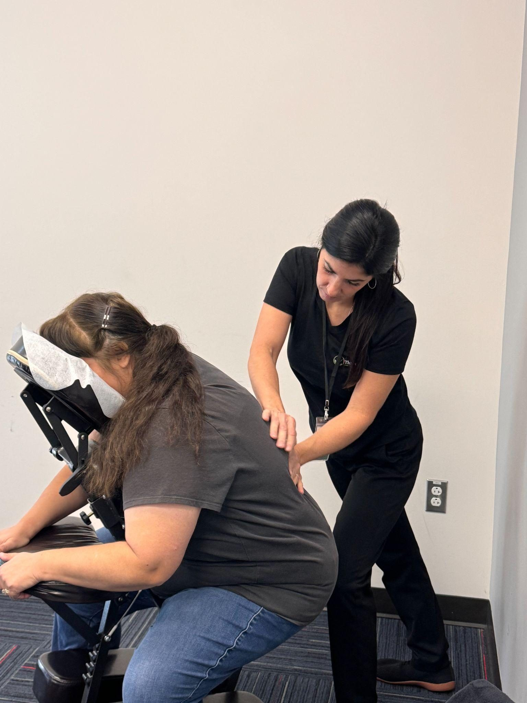
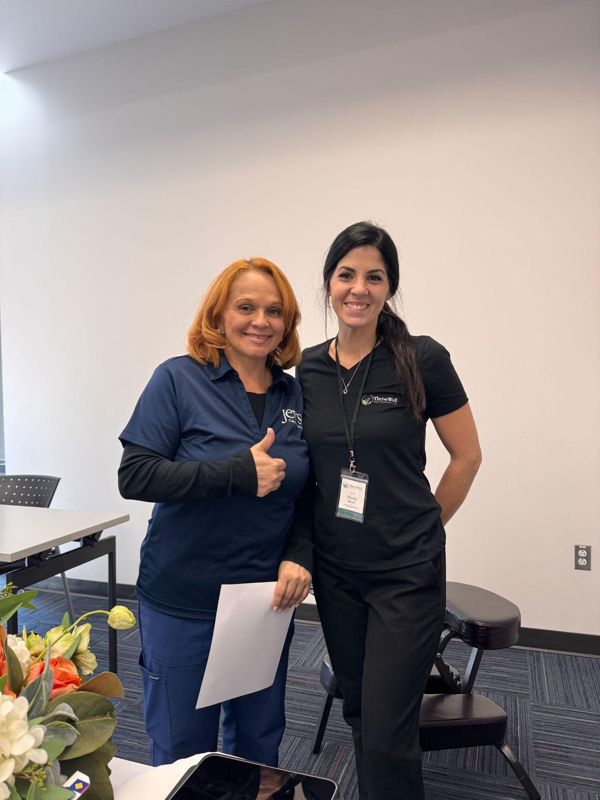
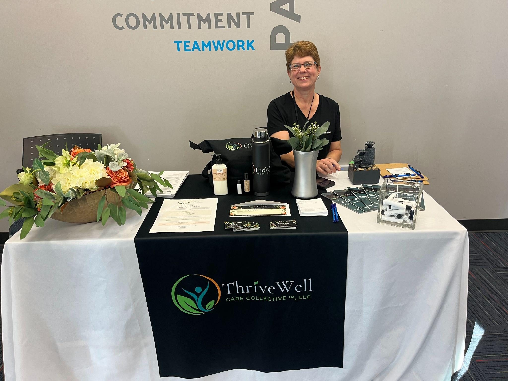

On November 7, 2026, ThriveWell Care Collective™ had the pleasure of participating in the **5th Annual Health & Wellness Expo hosted by Cetronia Ambulance Corps** in Allentown, Pennsylvania.

It was an opportunity to introduce ThriveWell to our Lehigh Valley community, connect with fellow wellness professionals, and meet people whose lives involve caring for, supporting, and serving others.

We especially appreciated the conversations, thoughtful questions, and genuine interest in the wellness experiences we're bringing to our community.

## Meaningful Conversations with Caregivers

One of the most rewarding parts of the day was meeting caregivers from many walks of life—mothers, family caregivers, healthcare professionals, and women who support their workplaces and communities.

We heard stories, shared experiences, and talked about something many caregivers have in common: finding opportunities to care for themselves isn't always easy.

Whether someone is managing family responsibilities, providing professional care, or supporting others in their community, it's easy for personal well-being to become secondary to everything else that needs attention.

What stood out most was the interest people expressed in having accessible opportunities to pause and care for themselves.

We appreciated hearing their questions, learning about their experiences, and discussing how ThriveWell's services might fit into their lives.

These conversations reinforced something we believe deeply: **the people who spend so much of their time caring for others deserve opportunities to receive care, too.**

## Experiencing Wellness, One Moment at a Time

Throughout the expo, Amanda "Mandy" Koch, LMT, our Co-Founder and Director of Wellness Services & Client Care, offered complimentary chair massages, giving visitors an opportunity to take a break from the day's activities and experience ThriveWell's approach to restorative wellness.

Mandy also introduced visitors to a simple equal-count breathing practice drawn from Sama Vritti Pranayama.

Participants were invited to breathe in gently for 4 counts and out for 4 counts, maintaining a comfortable, even rhythm without forcing or holding their breath.

This accessible practice offers an opportunity to pause, focus attention on the breath, and reconnect with the present moment.

Together, these experiences helped bring our **Arrive • Notice • Release • Return™** approach to life:

- **Arrive** — Take a moment to pause, settle in, and become present.

- **Notice** — Pay attention to your breathing, how your body feels, and what you might need.

- **Release** — Allow yourself an opportunity to relax through massage, mindful breathing, and a brief break from everyday demands.

- **Return** — Reconnect with your day, carrying forward a little more awareness and intention.

One of the things we appreciate about these experiences is their simplicity. They offer an opportunity to slow down without requiring an elaborate routine or a significant time commitment.

Of course, brief moments of relaxation cannot resolve every challenge caregivers face. Meaningful rest, practical support, and access to appropriate resources remain important.

But sometimes taking a few minutes to notice how we're feeling can remind us that our own needs deserve attention.

## A Community That Cares

Beyond introducing ThriveWell's massage and restorative wellness services, we appreciated meeting other local organizations and wellness professionals who are working to support the health and well-being of Lehigh Valley residents.

Community events like the Cetronia Health & Wellness Expo create opportunities to learn about available resources, exchange ideas, and develop relationships that can continue beyond a single afternoon.

For us, these connections are an important part of building ThriveWell.

We believe meaningful community involvement begins with listening, understanding what matters to people, and exploring opportunities to support one another.

We left the expo with new connections, valuable conversations, and an even greater appreciation for the people and organizations serving our community.

## Thank You for Welcoming ThriveWell!

A special thank-you to **Cetronia Ambulance Corps** for organizing and hosting such a welcoming, community-focused event.

We're also grateful to **The Bath Soap Company** for generously donating lip balms to share with visitors at our booth. Thoughtful contributions like these helped make our participation even more special.

And to everyone who stopped by, experienced a chair massage, practiced mindful breathing, shared a story, asked a question, or offered encouragement—**thank you!**

Your kindness and support mean so much to us.

We appreciate the opportunity to introduce ThriveWell to our community, and we look forward to continuing the conversations and building the connections that began at the expo.

## Continuing the Connection

At ThriveWell Care Collective™, we're committed to creating opportunities for people who care for others to pause, restore, and reconnect with themselves.

Through professional massage therapy, guided relaxation, mindfulness, reflection, virtual wellness experiences, and workplace programs, we offer different ways to make room for personal well-being.

We also believe in building relationships with local organizations, businesses, and community members who share an interest in supporting those who care for others.

If we met you at the expo, we'd love to stay connected. And if you're just learning about ThriveWell, we invite you to explore what we offer.

**[<u>Learn more about ThriveWell's wellness services and experiences</u>](https://thrivewellcarecollective.com/services/).**

Our guiding commitment remains:

Restoring energy, empathy, and capacity for those who care.

Because those who spend so much of their lives caring for others deserve care, too.

With gratitude,

**Laura & Mandy**
ThriveWell Care Collective™
